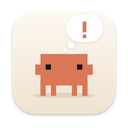
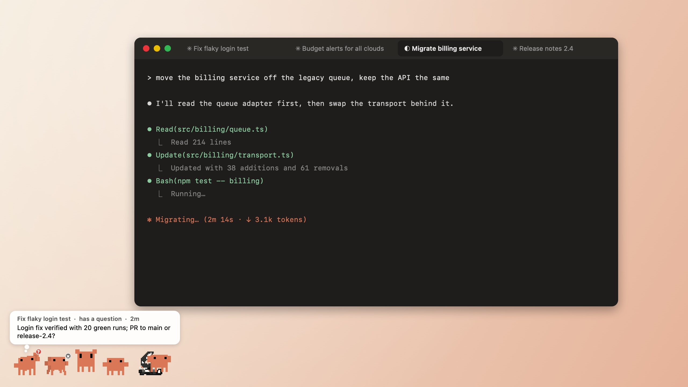
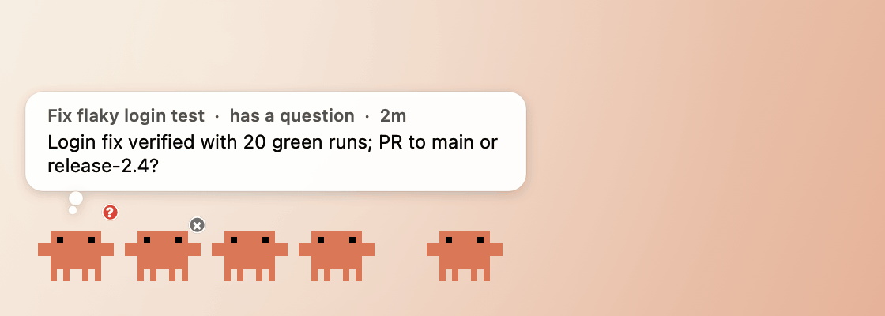
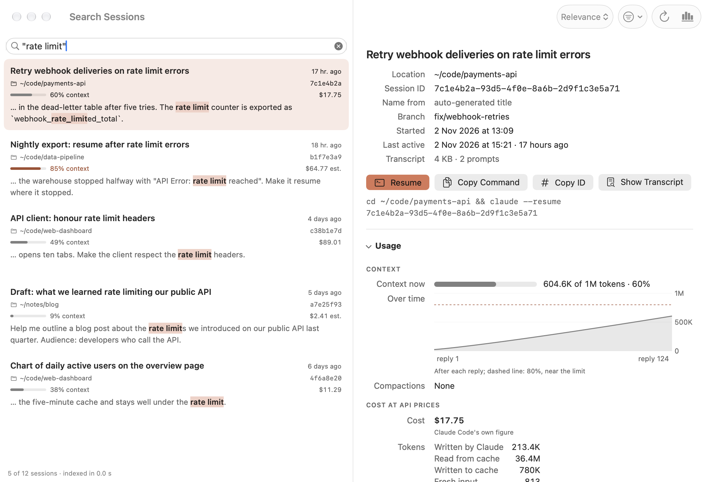
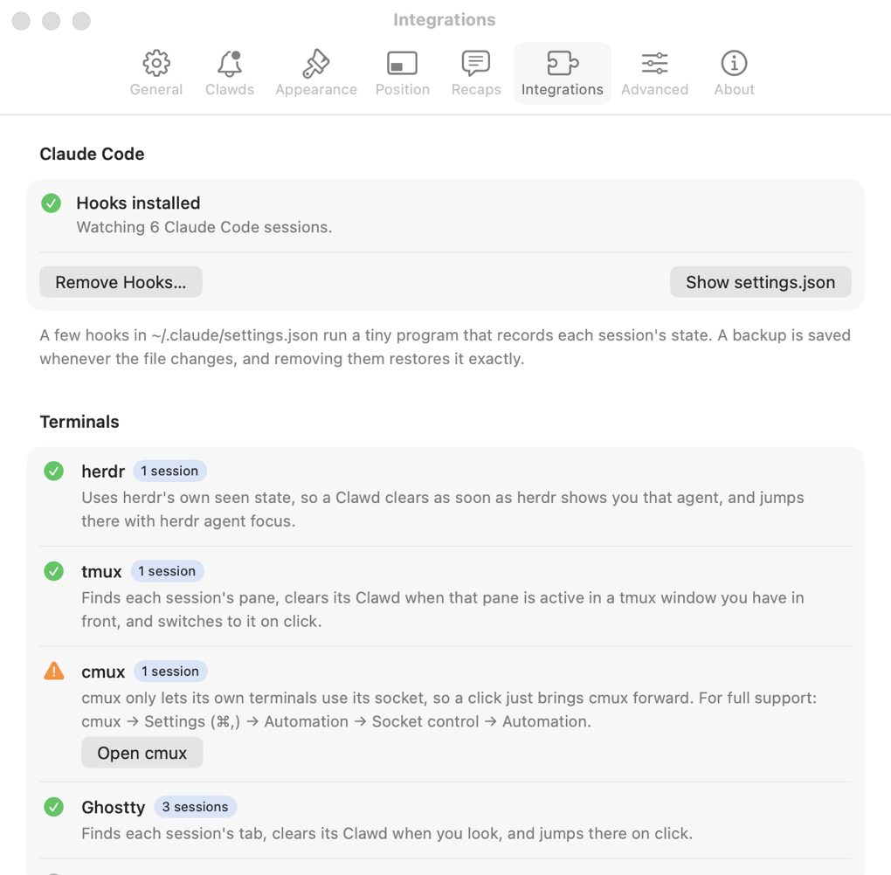
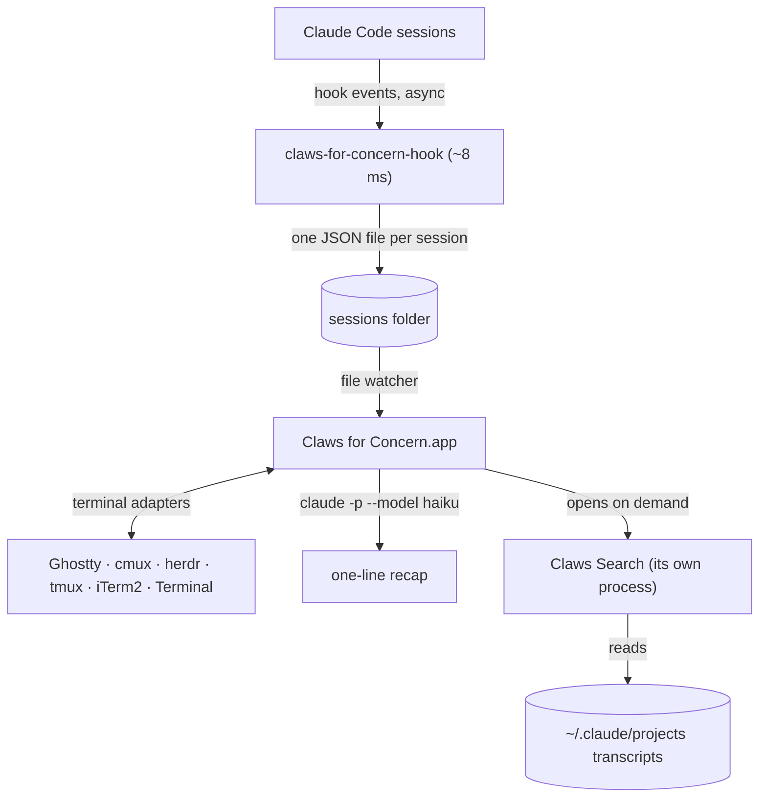
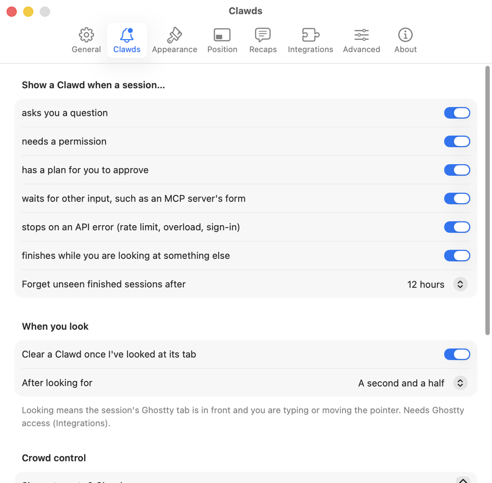
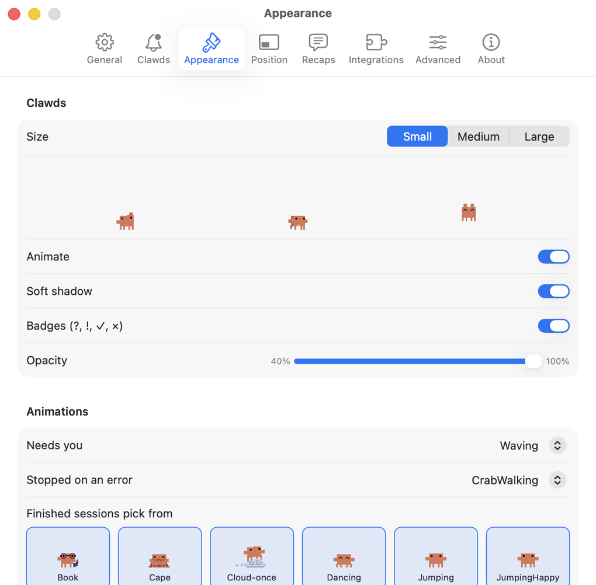
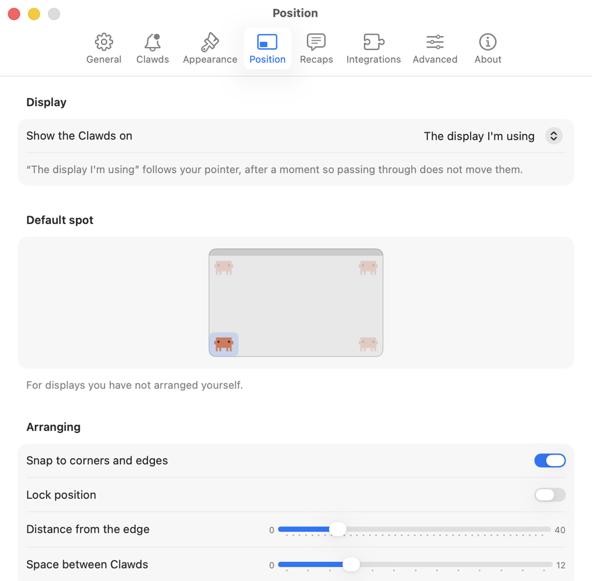

<p align="center">
  
</p>

<h1 align="center">Claws for Concern</h1>

<p align="center">
  <b>Tiny Clawds in the corner of your screen whenever a Claude Code session needs you.</b><br>
  Search every conversation you have had, and get them all back when your terminal restarts.<br>
  A native macOS menu bar app. No Electron, no API key, nothing to configure.
</p>

<p align="center">
  <a href="https://github.com/patildhruv/claws-for-concern/releases/latest"></a>
  
  
  <a href="LICENSE"></a>
</p>

<picture>
  <source media="(prefers-color-scheme: dark)" srcset="docs/media/hero-dark.jpg">
  
</picture>

You have six Claude Code sessions going. One is waiting on a permission prompt, one finished ten minutes
ago, one died on a rate limit, and you are busy in a seventh tab.

Claws for Concern puts a small animated Clawd in the corner of your screen for each session that
needs you. **Hover** for a one-line recap of where it stopped. **Click** to jump straight to its tab.
**Look at the tab** and the Clawd quietly leaves.

It also finds any past session by what was said in it, and when Ghostty quits and reopens its tabs,
it brings back the conversations that were running in them.

## What you see

<p align="center">
  
</p>

| Clawd | Means |
| --- | --- |
| Waving, red **?** | Claude asked you a question |
| Waving, red **!** | Claude needs a permission or some input |
| Waving, red **✓** | Claude has a plan waiting for your approval |
| Grey **×** | The turn stopped on an API error: rate limit, overload, auth |
| Dancing, jumping, racing, floating | Finished while you were looking elsewhere |

Each finished session keeps its own Clawd, so a row of them stays easy to tell apart.

- **Hover**: a thought bubble with the session's title, its state and age, and a one-line recap
  written by Claude Haiku.
- **Click**: jumps to the exact tab or pane in Ghostty, cmux, herdr, tmux, iTerm2 and Terminal.
  Anywhere else, the app hosting the session comes to the front.
- **Right-click**: Open, Dismiss, Copy Recap, Copy Resume Command, Dismiss All.
- **Drag**: move the whole row anywhere (see below).
- **⌃⌥⌘C** (or a shortcut of your own): jump to the most urgent session, from anywhere.
- **Menu bar crab**: how many sessions need you, the list, Pause, and Settings.

A Clawd never appears for a session you are already looking at. It goes away when you have actually
seen the session (its tab or pane in front, and you active for a moment), when you click it, or when
you send that session your next prompt.

## Arrange them your way

Drag any Clawd and the whole row follows. Drop it near a corner or an edge and it snaps there;
anywhere else, it stays exactly where you let go. The whole display is yours, right down to its
corners and the Dock's strip; only the menu bar is kept clear (or switch on *Keep clear of the Dock*).

- **Every display remembers its own spot.** Move the row to the middle of your external monitor and to
  the top-right of your laptop screen; each keeps its place, and a display you have never arranged uses
  the default corner.
- **They come with you.** By default the row moves to the display you are using (after a moment, so
  passing the pointer across does not drag it along). You can also pin it to the main display or any
  particular one.
- **They never fall off the edge.** The most urgent Clawd stays exactly where you put it. The rest line
  up to its right, and when there is no room on the right they flip to the left on their own. Near the
  top of the screen, the bubble opens below instead.
- **Crowded?** Past a limit you set, extra sessions wait behind a small **+N** chip.
- **Need quiet?** Menu bar crab → Pause Clawds, for 15 minutes up to tomorrow morning.

## Find any session

**Open Claws for Concern** (Spotlight, the Dock or Finder) or choose **Search Sessions…** from the menu bar
crab, and search every Claude Code conversation on your Mac: your prompts, Claude's replies, tool calls
and subagents, plus each session's name, folder and ID. ⌘, from there opens Settings.

<picture>
  <source media="(prefers-color-scheme: dark)" srcset="docs/media/search-dark.png">
  
</picture>

- **Type words, a `"quoted phrase"`, a folder or an ID.** Words forgive a typo or an unfinished word;
  quotes match exactly. Sort by relevance or by most recent.
- **Return resumes** the selected session in a new tab, in the folder it was started in, with your
  resume command (Settings → General). If it is still running, you are taken to its tab instead.
- **Copy Command**, **Copy ID** and **Show Transcript** for everything else.
- **Light on your Mac.** Search is a small app of its own inside Claws for Concern. It builds its index
  when you open it (a few seconds for hundreds of sessions) and quits when you close the window, so the
  memory it needs is never held by the always-running app.

## Pick up where Ghostty left off

Quit Ghostty, or restart your Mac, and every Claude Code session in it ends. When Ghostty reopens its
tabs, Claws for Concern offers to resume each conversation in the tab it was running in:

> Ghostty reopened 4 tabs that were running Claude Code. Resume them?

Choose **Resume** (or tick *Always resume without asking*) and your resume command is typed into each
tab. It is careful about where and when:

- Only into a tab Ghostty has **just reopened**, sitting idle at your shell, in that session's folder.
- Never into a tab you are typing in: it waits until you pause.
- Never for a session you ended yourself (`/exit`, Ctrl-C) or a tab you closed. Only sessions that
  ended because Ghostty quit, crashed or the Mac restarted come back.
- Once per relaunch. Not now means not now.
- It never answers a question for you. A session in a folder Claude Code asks you to trust (your home
  folder always asks) waits at that question until you answer it.

Restore needs Ghostty 1.4 or later with `window-save-state = always` in its config, so that Ghostty
brings its tabs back. Settings → General → Restore says if yours does not. Other terminals can add
restore through the same adapter that finds their panes ([docs/adapters.md](docs/adapters.md)).

## Works with your terminal

Clawds and recaps work everywhere Claude Code runs. These terminals also get pane-level support:
finding a session's tab or pane, clearing its Clawd when you look at it, and jumping there on click.

| Terminal | How it knows the pane | When a Clawd clears |
| --- | --- | --- |
| **Ghostty** | the tab's tty (Ghostty 1.4+); on 1.3, learns the tab you type each prompt into | the tab is in front and you are active |
| **cmux** | the surface ID cmux gives every shell | the surface is focused and you are active |
| **herdr** | the pane ID herdr gives every shell | herdr marks the agent seen (it is visible in a herdr client) |
| **tmux** | `TMUX_PANE` | the pane is active in a tmux client whose window is in front |
| **iTerm2** | the session's tty | the session is in front and you are active |
| **Terminal** | the tab's tty | the tab is in front and you are active |
| Anything else | | you prompt that session again, or dismiss it |

<p align="center">
  
</p>

Ghostty, iTerm2 and Terminal ask once for permission to read and switch their tabs. cmux needs one
setting for pane-level control: cmux → Settings → Automation → Socket control → **Automation**
(otherwise a click just brings cmux forward). Settings → Integrations shows each terminal's status
and the fix if one is needed.

**Missing yours?** Supporting a terminal is one Swift file: [docs/adapters.md](docs/adapters.md) walks
you, or your own Claude, through it.

## Install

**Download.** Grab `Claws-for-Concern.zip` from the [latest release](https://github.com/patildhruv/claws-for-concern/releases/latest),
unzip, and move the app to `/Applications`. The app is not notarized, so the first time, right-click it
and choose **Open** (or run `xattr -dr com.apple.quarantine "/Applications/Claws for Concern.app"`).

**Or build it** (Xcode Command Line Tools, macOS 14+):

```sh
git clone https://github.com/patildhruv/claws-for-concern.git
cd claws-for-concern
./build.sh            # builds and installs to /Applications
```

**First launch** takes three clicks:

1. **Install Hooks.** Adds a few entries to `~/.claude/settings.json`; a backup is saved next to it,
   and nothing else in the file changes. Running sessions pick them up on their own.
2. **Allow access to your terminal** (optional; Ghostty asks now, iTerm2 and Terminal the first time
   one of their sessions gets a Clawd). Lets the app see which tab is in front and switch tabs.
3. **Open at login** (optional, ticked by default).

The app then downloads the Clawd animations from claude.ai (about 1.3 MB, once) and converts them
into tiny pixel-exact sprite sheets.

## How it works



- **Hooks**: `SessionStart`, `UserPromptSubmit`, `PreToolUse` (for `AskUserQuestion` and `ExitPlanMode`),
  `PermissionRequest`, `Notification` (permission and input prompts), `PostToolUse`, `PostToolUseFailure`,
  `Stop`, `StopFailure` and `SessionEnd`. All but `SessionEnd` run asynchronously, so Claude never waits.
- **Which pane is which**: the hook records the terminal's own IDs for the session (`TMUX_PANE`, the
  cmux surface, the herdr pane, the tty) from an allow-list, never anything secret. Ghostty 1.4 reports
  each tab's tty, so a session maps to its tab exactly; on Ghostty 1.3 the app remembers the tab you were
  typing in when you sent each prompt, and otherwise matches the folder and the tab's title.
- **Restore**: when a session ends, the hook records why. A session that ended because its terminal
  went away (Claude Code reports `other`) is remembered with its tab for 7 days; `/exit` and Ctrl-C
  (`prompt_input_exit`), `/clear` and logging out are forgotten. When Ghostty relaunches, the remembered
  tabs that came back idle in the right folder get the resume command.
- **Search** runs as a separate helper app. It asks Claws to resume a session with a one-time key Claws
  gave it at launch, and only while its window is in front; Claws checks the session's folder against
  Claude Code's own record before typing anything.
- **Recaps**: `claude -p --model haiku` through the Claude Code install and login already on your Mac,
  so there is no API key. About 650 input and 25 output tokens per recap, three seconds, no tools, no MCP
  servers, nothing saved to your session history, and your own settings and hooks are not loaded.
- **Sessions that vanish** (a closed tab, a crash) are noticed when their Claude process exits.

## Privacy

Everything stays on your Mac except the recap request: Claude's final message of a turn (up to
12,000 characters) goes to Anthropic through your own Claude Code login, the same way every Claude
Code request does. Turn recaps off in Settings → Recaps and the bubble shows the first sentence instead.

The app reads only what the hooks record, plus the title records in each session's transcript. It never
reads your code or your terminal. Its files live in `~/Library/Application Support/Claws for Concern/`.

Search reads your transcripts in `~/.claude/projects` on your Mac, only while its window is open, and
sends nothing anywhere. It never looks inside Documents, Desktop, Downloads, iCloud or other protected
folders, so macOS never asks you about them on its behalf.

## Settings

Menu bar crab → **Settings…**, or **⌘,** in the Search window (opening the app from Spotlight brings up
Search). Starting at login stays quiet. While Settings is open the
app gets a Dock icon and a menu bar, like any Mac app, and drops them when you close it.

<p align="center">
  
  
  
</p>

| Tab | What you can change |
| --- | --- |
| **General** | Open at login · menu bar crab and its count · what a click does · the global shortcut (record your own) · the resume command · Restore: offer to resume sessions when Ghostty reopens their tabs, or resume them without asking · Preview |
| **Clawds** | Which situations get a Clawd (questions, permissions, plans, MCP input, errors, finished) · forget unseen finished ones after 1–24 h · clear on look, and after how long · how many before the +N chip · a sound (any system sound) · macOS notifications, which wait for the recap and click through to the session |
| **Appearance** | Small, Medium or Large (always whole device pixels, so the art stays crisp) · animate · soft shadow · badges · opacity · which animation means "needs you" and "error" · which ones finished sessions pick from, with live previews · the bubble: on or off, hover delay, 11–13 pt text, 1–4 lines, which details to show, with a live preview |
| **Position** | The display (the one you are using, the main one, or a particular one) · the default corner · snapping · keep clear of the Dock · lock · distance from the edge · spacing · reset every display |
| **Recaps** | On or off · Claude Haiku or Sonnet · short, normal or long · your own instructions · a try-it box · which `claude` to use · clear saved recaps |
| **Integrations** | Claude Code hooks: status, install, repair, remove · every terminal: status, sessions, and the fix it needs (permission, cmux's socket mode) · the Clawd art: download again, edit the extra-art list |
| **Advanced** | Data folder and log · reset all settings · uninstall |

For scripts, everything lives in the `io.github.patildhruv.claws-for-concern` defaults domain, and the
app has a small command line (`ClawsForConcern --help`).

## Requirements

- macOS 14 Sonoma or later
- [Claude Code](https://docs.claude.com/en/docs/claude-code) (the native installer or Homebrew)
- Any terminal. Pane-level support in Ghostty 1.3+, cmux, herdr, tmux, iTerm2 and Terminal (see above).
- Restore: Ghostty 1.4+ with `window-save-state = always`.

## Uninstall

Settings → Advanced → **Uninstall…** removes the hooks and quits; then drag the app to the Trash. To remove
every trace:

```sh
rm -rf ~/Library/Application\ Support/Claws\ for\ Concern
defaults delete io.github.patildhruv.claws-for-concern
```

## Troubleshooting

- **No Clawds at all.** Settings → Integrations should say *Hooks installed*. Then send any session a
  prompt and switch to another app before it finishes. **Preview the Clawds** shows what to expect, and
  check you have not paused them (the menu bar crab greys out).
- **A Clawd will not go away when I look at its tab.** Settings → Integrations shows your terminal's
  status and what it needs. In Ghostty, a session the app has not matched yet learns its tab from your
  next prompt. `ClawsForConcern --terminals` shows what the app sees for every session.
- **Recaps never arrive.** Run
  `"/Applications/Claws for Concern.app/Contents/MacOS/ClawsForConcern" --recap "test"`: it uses the same
  code path and prints the error. Settings → Recaps → Try it does the same.
- **Restore did not offer to resume.** Settings → General → Restore must be on, and Ghostty must reopen
  its tabs (`window-save-state = always`; Settings warns if not). A tab is skipped if it reopened in
  another folder or was not idle. `ClawsForConcern --restore-status` lists each remembered session and
  why it would or would not be resumed.
- **Search says a session cannot be resumed.** Its folder no longer exists, or Claude Code never recorded
  it. Copy Command still gives you the command to run yourself.
- **The shortcut does nothing.** Another app has it; the log (Settings → Advanced → Log) says so. Record a
  different one in Settings → General.

## Development

```sh
./build.sh --no-install                 # build into build/
B="build/Claws for Concern.app/Contents/MacOS/ClawsForConcern"
"$B" --selftest                         # unit checks; prints ALL PASS
"$B" --terminals                        # what the terminal adapters see, per session
"$B" --help                             # the other commands
tools/make-readme-media.sh              # re-render the images in this README (Search uses demo data)
```

Plain `swiftc`, no Xcode project and no dependencies. [`CONTRIBUTING.md`](CONTRIBUTING.md) has the rules,
[`docs/adapters.md`](docs/adapters.md) how to add a terminal, [`docs/code-map.md`](docs/code-map.md) which file
does what, and [`CLAUDE.md`](CLAUDE.md) the traps found while building it.

## Credits

An unofficial fan project, not affiliated with or endorsed by Anthropic. **Clawd is Anthropic's
character**: this repository and its release builds contain none of Anthropic's artwork. The app
downloads the Clawd animations from claude.ai on your own Mac at first launch (the screenshots above
show them). The app icon and the menu bar crab are original drawings.

Why the name? Because six unattended agents are, frankly, claws for concern.

Code released under the [MIT license](LICENSE).
