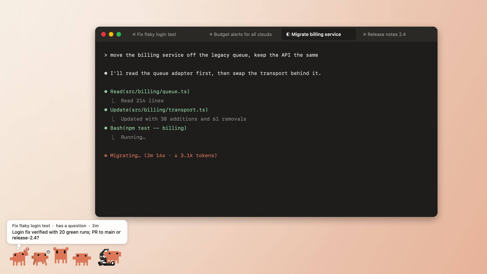
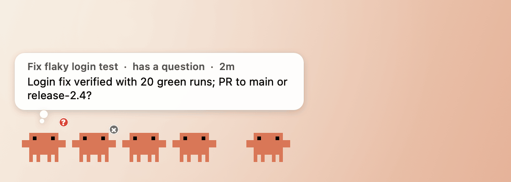
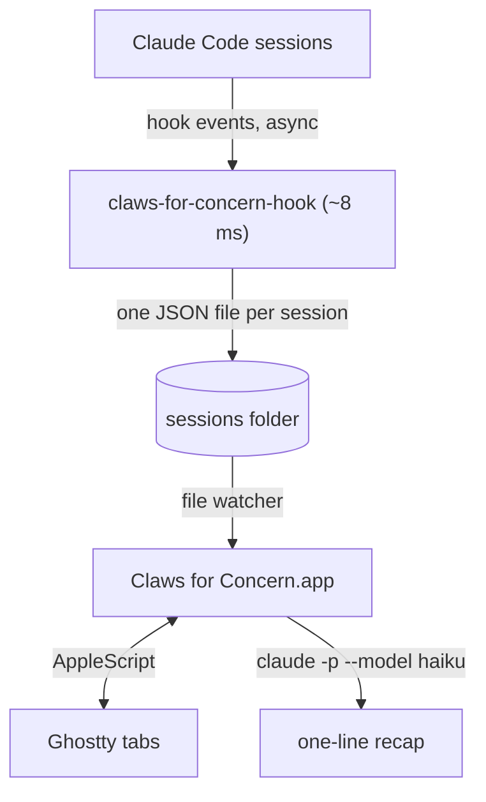
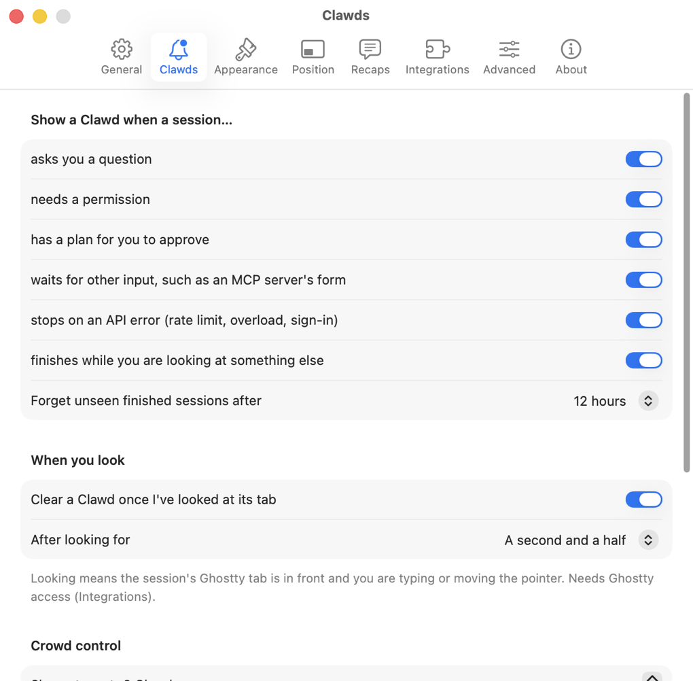
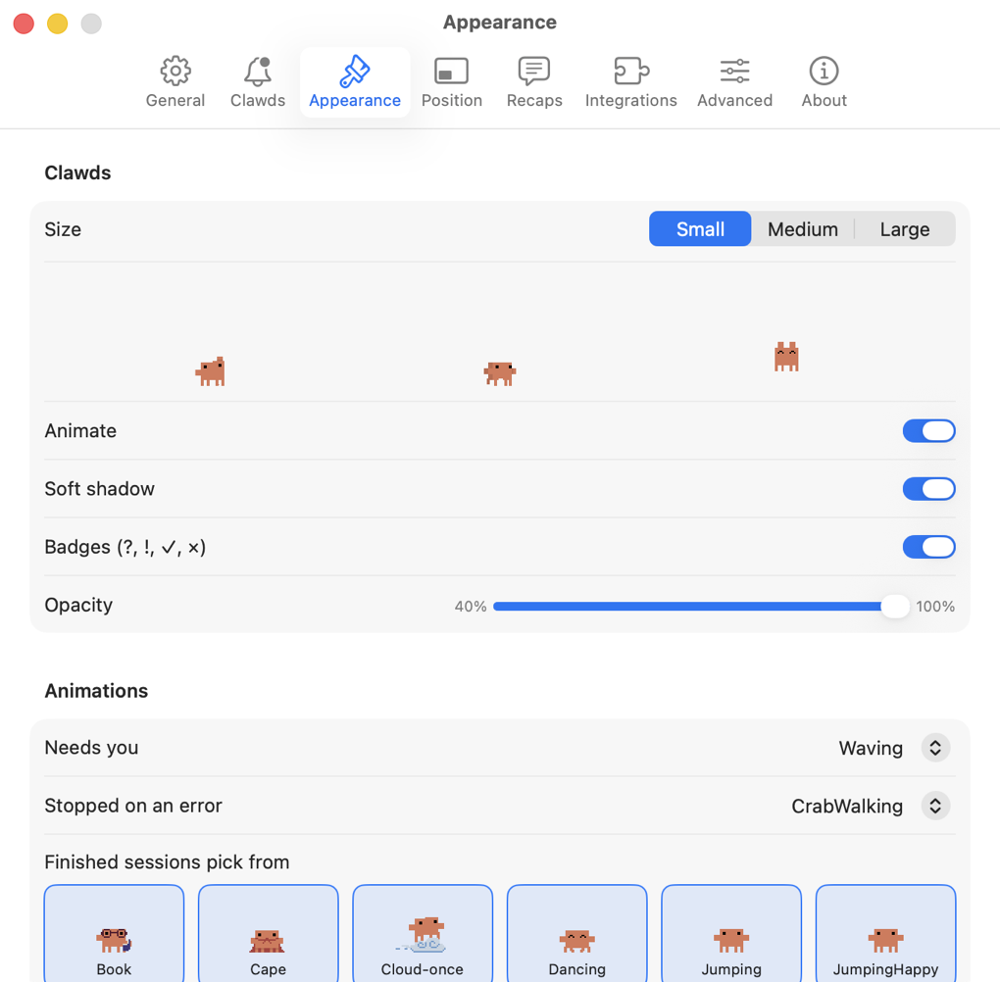
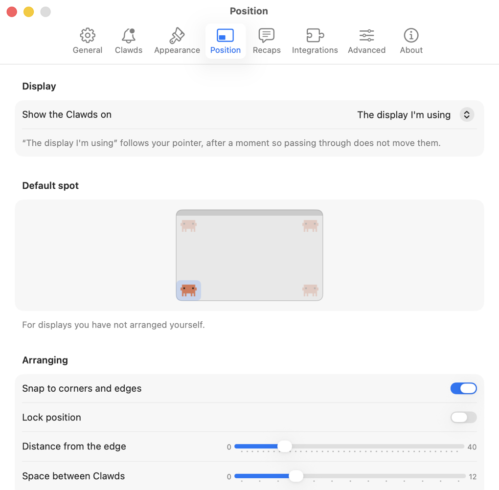

<p align="center">
  
</p>

<h1 align="center">Claws for Concern</h1>

<p align="center">
  <b>Tiny Clawds in the corner of your screen whenever a Claude Code session needs you.</b><br>
  A native macOS menu bar app. No Electron, no API key, nothing to configure.
</p>

<p align="center">
  <a href="https://github.com/patildhruv/claws-for-concern/releases/latest"></a>
  
  
  <a href="LICENSE"></a>
</p>

<picture>
  <source media="(prefers-color-scheme: dark)" srcset="docs/media/hero-dark.jpg">
  
</picture>

You have six Claude Code sessions going. One is waiting on a permission prompt, one finished ten minutes
ago, one died on a rate limit, and you are busy in a seventh tab.

Claws for Concern puts a small animated Clawd in the corner of your screen for each session that
needs you. **Hover** for a one-line recap of where it stopped. **Click** to jump straight to its tab.
**Look at the tab** and the Clawd quietly leaves.

## What you see

<p align="center">
  
</p>

| Clawd | Means |
| --- | --- |
| Waving, red **?** | Claude asked you a question |
| Waving, red **!** | Claude needs a permission or some input |
| Waving, red **✓** | Claude has a plan waiting for your approval |
| Grey **×** | The turn stopped on an API error: rate limit, overload, auth |
| Dancing, jumping, racing, floating | Finished while you were looking elsewhere |

Each finished session keeps its own Clawd, so a row of them stays easy to tell apart.

- **Hover**: a thought bubble with the session's title, its state and age, and a one-line recap
  written by Claude Haiku.
- **Click**: Ghostty focuses the exact tab (and split). With other terminals, the app that hosts the
  session comes to the front.
- **Right-click**: Open, Dismiss, Copy Recap, Copy Resume Command, Dismiss All.
- **Drag**: move the whole row anywhere (see below).
- **⌃⌥⌘C** (or a shortcut of your own): jump to the most urgent session, from anywhere.
- **Menu bar crab**: how many sessions need you, the list, Pause, and Settings.

A Clawd never appears for a session you are already looking at. It goes away when you have actually
seen the session (its Ghostty tab in front, and you active for a second), when you click it, or when
you send that session your next prompt.

## Arrange them your way

Drag any Clawd and the whole row follows. Drop it near a corner or an edge and it snaps there;
anywhere else, it stays exactly where you let go.

- **Every display remembers its own spot.** Move the row to the middle of your external monitor and to
  the top-right of your laptop screen; each keeps its place, and a display you have never arranged uses
  the default corner.
- **They come with you.** By default the row moves to the display you are using (after a moment, so
  passing the pointer across does not drag it along). You can also pin it to the main display or any
  particular one.
- **They never fall off the edge.** The most urgent Clawd stays exactly where you put it. The rest line
  up to its right, and when there is no room on the right they flip to the left on their own. Near the
  top of the screen, the bubble opens below instead.
- **Crowded?** Past a limit you set, extra sessions wait behind a small **+N** chip.
- **Need quiet?** Menu bar crab → Pause Clawds, for 15 minutes up to tomorrow morning.

## Install

**Download.** Grab `Claws-for-Concern.zip` from the [latest release](https://github.com/patildhruv/claws-for-concern/releases/latest),
unzip, and move the app to `/Applications`. The app is not notarized, so the first time, right-click it
and choose **Open** (or run `xattr -dr com.apple.quarantine "/Applications/Claws for Concern.app"`).

**Or build it** (Xcode Command Line Tools, macOS 14+):

```sh
git clone https://github.com/patildhruv/claws-for-concern.git
cd claws-for-concern
./build.sh            # builds and installs to /Applications
```

**First launch** takes three clicks:

1. **Install Hooks.** Adds a few entries to `~/.claude/settings.json`; a backup is saved next to it,
   and nothing else in the file changes. Running sessions pick them up on their own.
2. **Allow Ghostty access** (optional). Lets the app see which tab is in front and switch tabs.
3. **Open at login** (optional, ticked by default).

The app then downloads the Clawd animations from claude.ai (about 1.3 MB, once) and converts them
into tiny pixel-exact sprite sheets.

## How it works



- **Hooks**: `SessionStart`, `UserPromptSubmit`, `PreToolUse` (for `AskUserQuestion` and `ExitPlanMode`),
  `PermissionRequest`, `Notification` (permission and input prompts), `PostToolUse`, `PostToolUseFailure`,
  `Stop`, `StopFailure` and `SessionEnd`. All but `SessionEnd` run asynchronously, so Claude never waits.
- **Which tab is which**: the app remembers the tab you were typing in when you sent each prompt. For
  sessions it has not seen you type into yet, it matches the folder and the session title Claude Code
  shows in the tab.
- **Recaps**: `claude -p --model haiku` through the Claude Code install and login already on your Mac,
  so there is no API key. About 650 input and 25 output tokens per recap, three seconds, no tools, no MCP
  servers, nothing saved to your session history, and your own settings and hooks are not loaded.
- **Sessions that vanish** (a closed tab, a crash) are noticed when their Claude process exits.

## Privacy

Everything stays on your Mac except the recap request: Claude's final message of a turn (up to
12,000 characters) goes to Anthropic through your own Claude Code login, the same way every Claude
Code request does. Turn recaps off in Settings → Recaps and the bubble shows the first sentence instead.

The app reads only what the hooks record, plus the title records in each session's transcript. It never
reads your code or your terminal. Its files live in `~/Library/Application Support/Claws for Concern/`.

## Settings

Menu bar crab → **Settings…** (⌘,), or open the app again from Applications. While Settings is open the
app gets a Dock icon and a menu bar, like any Mac app, and drops them when you close it.

<p align="center">
  
  
  
</p>

| Tab | What you can change |
| --- | --- |
| **General** | Open at login · menu bar crab and its count · what a click does · the global shortcut (record your own) · the resume command · Preview |
| **Clawds** | Which situations get a Clawd (questions, permissions, plans, MCP input, errors, finished) · forget unseen finished ones after 1–24 h · clear on look, and after how long · how many before the +N chip · a sound (any system sound) · macOS notifications, which wait for the recap and click through to the session |
| **Appearance** | Small, Medium or Large (always whole device pixels, so the art stays crisp) · animate · soft shadow · badges · opacity · which animation means "needs you" and "error" · which ones finished sessions pick from, with live previews · the bubble: on or off, hover delay, 11–13 pt text, 1–4 lines, which details to show, with a live preview |
| **Position** | The display (the one you are using, the main one, or a particular one) · the default corner · snapping · lock · distance from the edge · spacing · reset every display |
| **Recaps** | On or off · Claude Haiku or Sonnet · short, normal or long · your own instructions · a try-it box · which `claude` to use · clear saved recaps |
| **Integrations** | Claude Code hooks: status, install, repair, remove · Ghostty access: status, request, open the privacy pane · the Clawd art: download again, edit the extra-art list |
| **Advanced** | Data folder and log · reset all settings · uninstall |

For scripts, everything lives in the `io.github.patildhruv.claws-for-concern` defaults domain, and the
app has a small command line (`ClawsForConcern --help`).

## Requirements

- macOS 14 Sonoma or later
- [Claude Code](https://docs.claude.com/en/docs/claude-code) (the native installer or Homebrew)
- [Ghostty](https://ghostty.org) 1.3 or later for the tab-aware parts. With any other terminal the Clawds
  still appear; clicking brings that terminal forward, and a Clawd clears when you dismiss it or prompt
  that session again.

## Uninstall

Settings → Advanced → **Uninstall…** removes the hooks and quits; then drag the app to the Trash. To remove
every trace:

```sh
rm -rf ~/Library/Application\ Support/Claws\ for\ Concern
defaults delete io.github.patildhruv.claws-for-concern
```

## Troubleshooting

- **No Clawds at all.** Settings → Integrations should say *Hooks installed*. Then send any session a
  prompt and switch to another app before it finishes. **Preview the Clawds** shows what to expect, and
  check you have not paused them (the menu bar crab greys out).
- **A Clawd will not go away when I look at its tab.** Allow Ghostty access (Settings → Integrations). If
  it says some Clawds are not matched to a tab, send that session one prompt and the app will learn its tab.
- **Recaps never arrive.** Run
  `"/Applications/Claws for Concern.app/Contents/MacOS/ClawsForConcern" --recap "test"`: it uses the same
  code path and prints the error. Settings → Recaps → Try it does the same.
- **The shortcut does nothing.** Another app has it; the log (Settings → Advanced → Log) says so. Record a
  different one in Settings → General.

## Development

```sh
./build.sh --no-install                 # build into build/
B="build/Claws for Concern.app/Contents/MacOS/ClawsForConcern"
"$B" --selftest                         # unit checks; prints ALL PASS
"$B" --help                             # the other commands
tools/make-readme-media.sh              # re-render the images in this README
```

Plain `swiftc`, no Xcode project and no dependencies. [`docs/code-map.md`](docs/code-map.md) says which file
does what, and [`CLAUDE.md`](CLAUDE.md) lists the traps found while building it.

## Credits

An unofficial fan project, not affiliated with or endorsed by Anthropic. **Clawd is Anthropic's
character**: this repository and its release builds contain none of Anthropic's artwork. The app
downloads the Clawd animations from claude.ai on your own Mac at first launch (the screenshots above
show them). The app icon and the menu bar crab are original drawings.

Why the name? Because six unattended agents are, frankly, claws for concern.

Code released under the [MIT license](LICENSE).
